


  

 

 

Hey, I'm Sanjay, a software engineer working on backend systems, native apps and developer tools. Most of what I build is local-first: durable Python workflows on SQLite, a Rust PDF studio, macOS utilities in Swift, and a long tail of browser tools. I also spend a lot of time sending fixes upstream to language tooling, developer infrastructure and AI agent projects.

The quickest way to reach me is [LinkedIn](https://www.linkedin.com/in/sanjay24/).

## Slab

Slab on the desktop. <a href="https://sanjays2402.github.io/slab/">Website</a> · <a href="https://github.com/Sanjays2402/slab/releases/latest">Download</a>

[Slab](https://github.com/Sanjays2402/slab) is an offline PDF studio for macOS, Windows and Linux. It merges, splits, signs, redacts, OCRs and compares PDFs, with watched-folder automation and on-device AI for search, summaries and chat with citations. Everything runs locally.

## More things I've built

<table>
<tr>
<td width="50%" valign="top">
<a href="https://github.com/Sanjays2402/gitsight">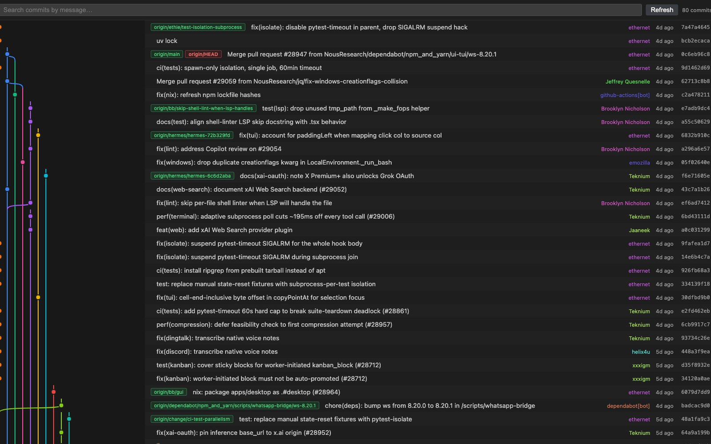</a>
<b><a href="https://github.com/Sanjays2402/gitsight">GitSight</a></b>: Git history inside VS Code. Commit graph, blame heatmap, interactive rebase, worktrees and PRs. 
<code>TypeScript</code> · <code>VS Code</code>
</td>
<td width="50%" valign="top">

<b><a href="https://github.com/Sanjays2402/Tilt">Tilt</a></b>: turns MacBook lid movement into live perspective, blur and dimming effects, rendered on the GPU. 
<code>Swift</code> · <code>Metal</code> · <code>ScreenCaptureKit</code>
</td>
</tr>
<tr>
<td width="50%" valign="top">
<a href="https://github.com/Sanjays2402/context-clipboard">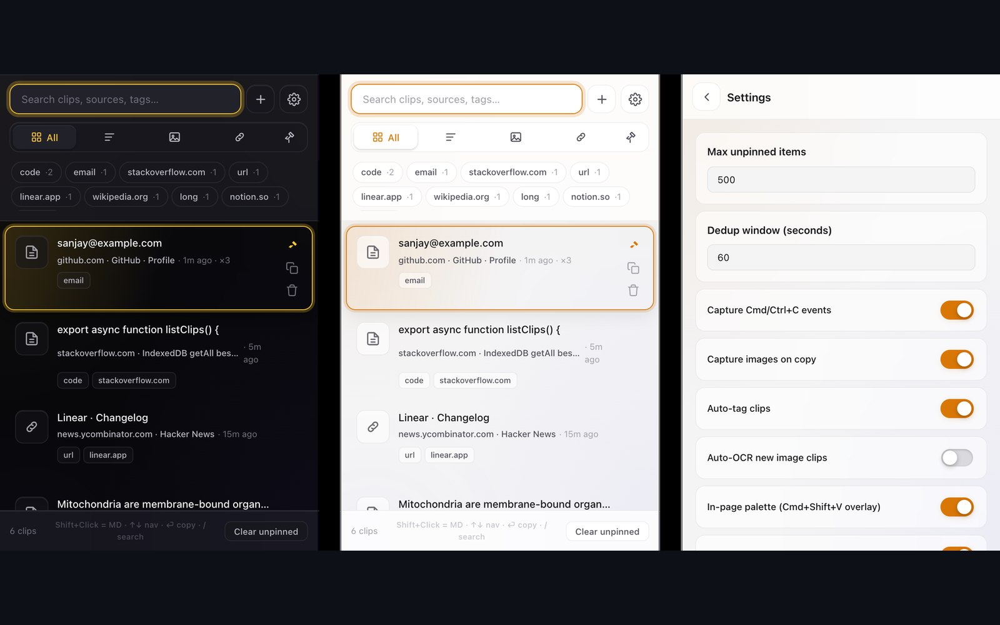</a>
<b><a href="https://github.com/Sanjays2402/context-clipboard">Context Clipboard</a></b>: a clipboard that remembers where you copied from: source URL, page title and surrounding paragraph. 
<code>TypeScript</code> · <code>Browser extension</code> · <a href="https://sanjays2402.github.io/context-clipboard/">Explore →</a>
</td>
<td width="50%" valign="top">
<a href="https://github.com/Sanjays2402/retrace">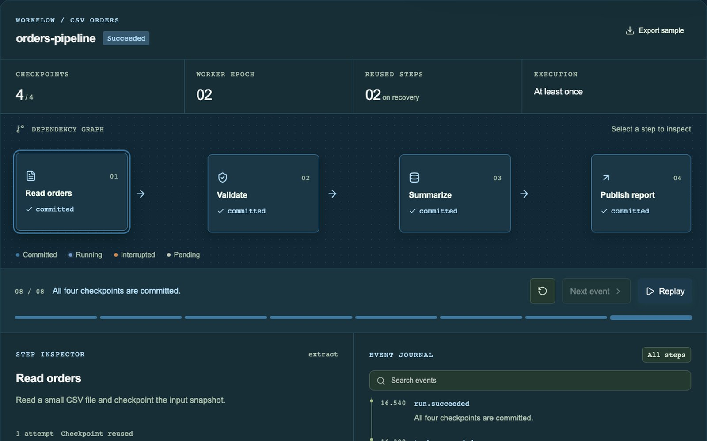</a>
<b><a href="https://github.com/Sanjays2402/retrace">retrace</a></b>: crash-resumable Python workflows. Durable SQLite checkpoints, retries and a live inspector. 
<code>Python</code> · <code>asyncio</code> · <a href="https://sanjays2402.github.io/retrace/">Playground →</a>
</td>
</tr>
<tr>
<td width="50%" valign="top">
<a href="https://github.com/Sanjays2402/optune"><picture>
  <source media="(prefers-color-scheme: dark)" srcset="https://raw.githubusercontent.com/Sanjays2402/Sanjays2402/main/profile/shots/optune-dark.jpg" />
  
</picture></a>
<b><a href="https://github.com/Sanjays2402/optune">Optune</a></b>: native macOS controls for Logitech MX devices. Battery, DPI, button remapping and per-app profiles. 
<code>Swift 6</code> · <code>SwiftUI</code> · <code>HID++</code> · <a href="https://github.com/Sanjays2402/homebrew-optune">Homebrew tap →</a>
</td>
<td width="50%" valign="top">
<a href="https://github.com/Sanjays2402/city-friction-map">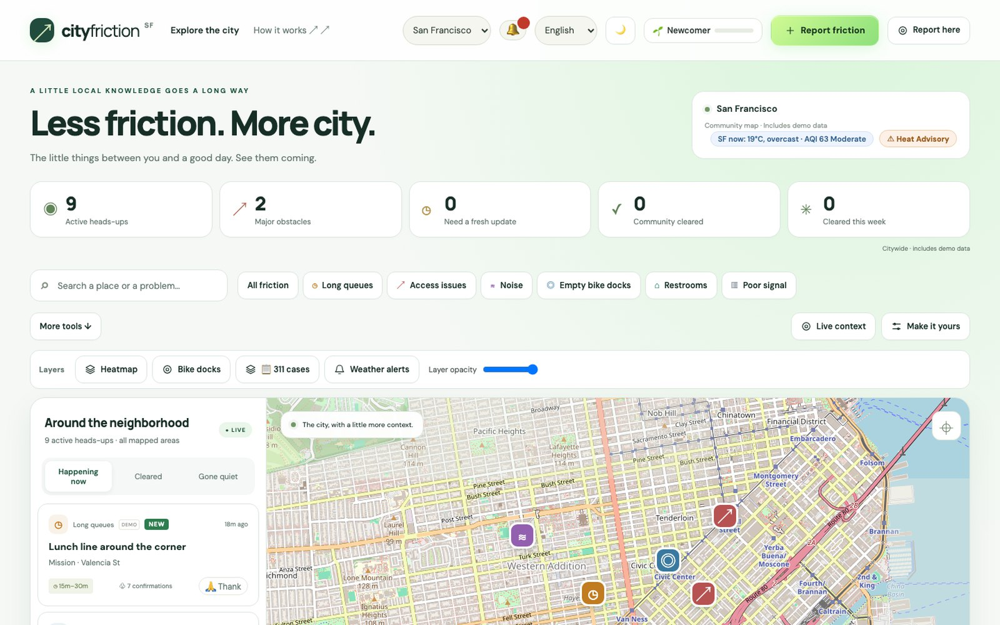</a>
<b><a href="https://github.com/Sanjays2402/city-friction-map">city-friction-map</a></b>: a community map of everyday city obstacles. Report, verify and share heads-ups, with GeoJSON export. 
<code>JavaScript</code> · <code>Express</code> · <code>SQLite</code> · <code>Leaflet</code>
</td>
</tr>
</table>

Also: [ferry](https://github.com/Sanjays2402/ferry) (task queue with crash recovery) · [tsk](https://github.com/Sanjays2402/tsk) (Markdown-backed terminal todos in Go) · [Snip](https://github.com/Sanjays2402/snip) (link analytics API) · [copilot-usage-tracker](https://github.com/Sanjays2402/copilot-usage-tracker) (Copilot spend and attribution) · [raft](https://github.com/Sanjays2402/raft) (Raft consensus core in pure Python)

## Open source

I've had more than 410 pull requests merged across 280+ open-source repositories, mostly Python tooling, developer infrastructure and AI agent frameworks. These are the projects I work in the most:

<a href="https://github.com/openclaw/openclaw/pulls?q=is%3Apr+author%3ASanjays2402+is%3Amerged">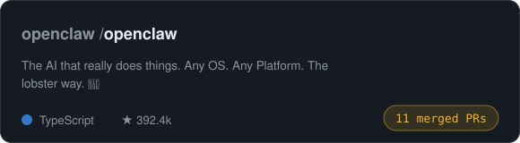</a>
<a href="https://github.com/pygments/pygments/pulls?q=is%3Apr+author%3ASanjays2402+is%3Amerged">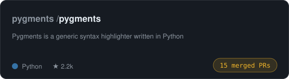</a>
<a href="https://github.com/nesquena/hermes-webui/pulls?q=is%3Apr+author%3ASanjays2402+is%3Amerged">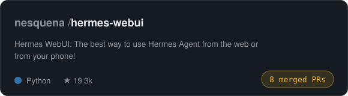</a>
<a href="https://github.com/fsspec/filesystem_spec/pulls?q=is%3Apr+author%3ASanjays2402+is%3Amerged">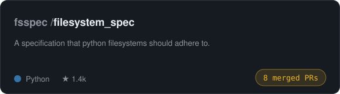</a>
<a href="https://github.com/apache/libcloud/pulls?q=is%3Apr+author%3ASanjays2402+is%3Amerged">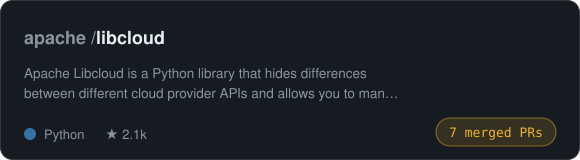</a>
<a href="https://github.com/rclone/rclone/pulls?q=is%3Apr+author%3ASanjays2402+is%3Amerged">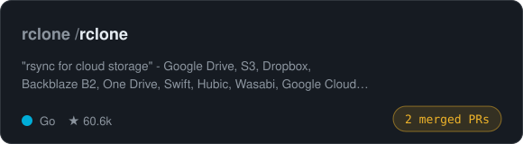</a>

I've also had PRs merged in [OpenHands](https://github.com/OpenHands/OpenHands/pulls?q=is%3Apr+author%3ASanjays2402+is%3Amerged), [uv](https://github.com/astral-sh/uv/pulls?q=is%3Apr+author%3ASanjays2402+is%3Amerged), [Ruff](https://github.com/astral-sh/ruff/pulls?q=is%3Apr+author%3ASanjays2402+is%3Amerged), [OpenBB](https://github.com/openbq-org/OpenBB/pulls?q=is%3Apr+author%3ASanjays2402+is%3Amerged), [Helix](https://github.com/helix-editor/helix/pulls?q=is%3Apr+author%3ASanjays2402+is%3Amerged), [LightRAG](https://github.com/HKUDS/LightRAG/pulls?q=is%3Apr+author%3ASanjays2402+is%3Amerged), [DeepTutor](https://github.com/HKUDS/DeepTutor/pulls?q=is%3Apr+author%3ASanjays2402+is%3Amerged), [1Panel](https://github.com/1Panel-dev/1Panel/pulls?q=is%3Apr+author%3ASanjays2402+is%3Amerged), [CyberChef](https://github.com/gchq/CyberChef/pulls?q=is%3Apr+author%3ASanjays2402+is%3Amerged), [Glances](https://github.com/nicolargo/glances/pulls?q=is%3Apr+author%3ASanjays2402+is%3Amerged), [Mantine](https://github.com/mantinedev/mantine/pulls?q=is%3Apr+author%3ASanjays2402+is%3Amerged), [openai-python](https://github.com/openai/openai-python/pulls?q=is%3Apr+author%3ASanjays2402+is%3Amerged), [tqdm](https://github.com/tqdm/tqdm/pulls?q=is%3Apr+author%3ASanjays2402+is%3Amerged), [Dash](https://github.com/plotly/dash/pulls?q=is%3Apr+author%3ASanjays2402+is%3Amerged), [Tornado](https://github.com/tornadoweb/tornado/pulls?q=is%3Apr+author%3ASanjays2402+is%3Amerged), [Apprise](https://github.com/caronc/apprise/pulls?q=is%3Apr+author%3ASanjays2402+is%3Amerged), [ranger](https://github.com/ranger/ranger/pulls?q=is%3Apr+author%3ASanjays2402+is%3Amerged), [GoReleaser](https://github.com/goreleaser/goreleaser/pulls?q=is%3Apr+author%3ASanjays2402+is%3Amerged), [beets](https://github.com/beetbox/beets/pulls?q=is%3Apr+author%3ASanjays2402+is%3Amerged) and [Prowler](https://github.com/prowler-cloud/prowler/pulls?q=is%3Apr+author%3ASanjays2402+is%3Amerged).

The full list, the counting method and maintainer acknowledgments for incorporated work are in the [contribution audit](CONTRIBUTIONS.md).

## Stack

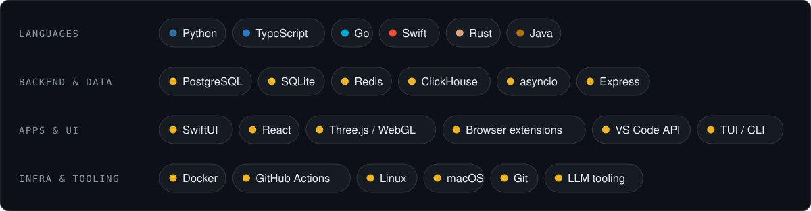

## Activity

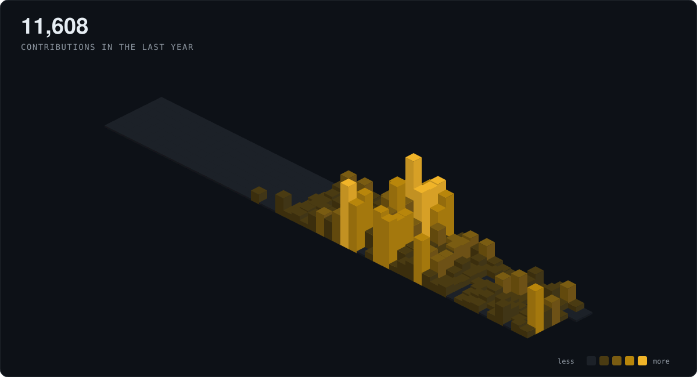

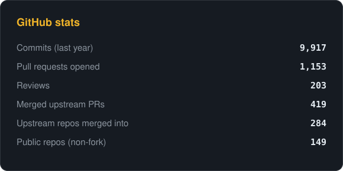
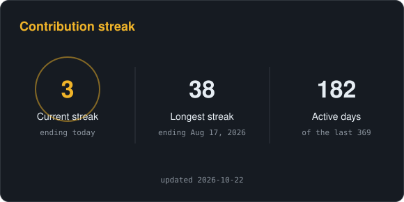

## Try it in your browser

- [Slab's PDF tools](https://sanjays2402.github.io/slab/): see what the desktop app does before downloading it
- [Retrace recovery playground](https://sanjays2402.github.io/retrace/): kill a workflow mid-run and watch it resume
- [Flight Simulator](https://sanjays2402.github.io/flight-sim/): a procedural world in a single HTML file
- [AI Particle Simulator](https://sanjays2402.github.io/ai-particle-simulator/): 3D particle presets with GIF and video export
- [Memory Matrix](https://sanjays2402.github.io/memory-matrix/): pair matching with streaks and a daily challenge

